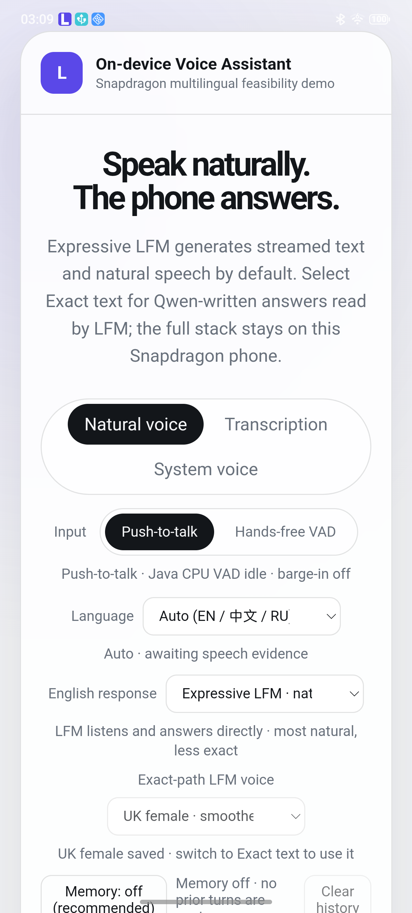

# Expressive LFM phone result

Version `0.4.13-expressive-lfm` was validated on a Nubia SM8850 phone on
2026-07-25.

English defaults to `Expressive LFM`:

1. SenseVoiceSmall transcribes on the HTP v81 NPU through QNN.
2. LFM2.5-Audio-1.5B Q4 generates one interleaved text-and-audio answer on CPU.
3. The displayed answer and spoken answer come from the same LFM response.

The visible `Exact text` fallback uses Qwen3-1.7B Q4 on CPU, followed by
fixed-text LFM speech. Memory and recall requests automatically use this exact
route even if Expressive LFM remains selected.

## Physical acceptance

| Case | Route | Result | First output-head | Estimated first voiced output | Audio | Underflows |
|---|---|---|---:|---:|---:|---:|
| Capital of France | Expressive LFM | Correct: Paris | 1.723 s | 2.543 s | 2.78 s | 0 |
| Four-sentence photosynthesis | Expressive LFM | Correct and complete | 1.744 s | 2.624 s | 26.62 s | 0 |
| Memory-off store request | Automatic Exact reroute | Correct refusal to store | 1.717 s | 1.957 s | 3.42 s | 0 |
| Capital of France | Exact text regression | Correct: Paris | 1.759 s | 1.959 s | 2.14 s | 0 |
| Four-sentence photosynthesis | Exact text regression | Correct and complete | 2.074 s | 2.354 s | 19.88 s | 0 |

All five cases passed their content, routing, backend, finish-reason, PCM,
repetition, and timing assertions. The Expressive route passed the 3-second
first-voiced-output gate in both cases.

The voiced timestamp scans decoded PCM at -45 dBFS and adds the leading-silence
offset to Android's WebAudio output-head estimate. It is stronger than
first-buffer scheduling, but it is not an external microphone measurement of
speaker acoustic onset.

## Artifact

- APK: `android-app/releases/lfm-audio-demo-0.4.13-expressive-lfm-debug.apk`
- SHA-256: `b178c93f05d614f8156843755ea52697f55b299c5bb0b6812209d9ce5f139baf`
- signer certificate SHA-256:
  `9ad7b2846b7c18853b99e444d4d05323321b3a9118c13c5a8fc242e58b5859e4`

Machine-readable measurements are in [results.json](results.json). The
acceptance plans are under `scripts/phone_acceptance_plans/`, and the host
harness is `scripts/run_phone_webview_acceptance.mjs`.

## Scope

This result is a phone demonstration, not an AR1 or glasses measurement.
SenseVoice ASR uses the NPU; LFM response generation, Qwen, Russian ASR, VAD,
and orchestration remain on CPU. Chinese, Russian, French, Italian, and Spanish
routes require their separate physical quality gates before being described as
production-ready.
